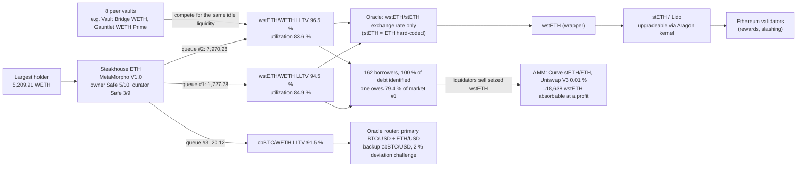

# ExitProof

**Exit tool for Morpho vaults: what do I really get back, and from what probability does leaving pay off.**

One protocol, MetaMorpho V1 on Morpho Blue. For a position, ExitProof executes the withdrawal on a fork of Ethereum frozen at block 26,157,638 (`0x3e84…7bf4`, 2026-10-09 21:47 UTC), alone and after other depositors leave first, and weighs the measured cost of leaving against the loss of staying through an incident. Every number can be replayed to the wei, offline.

> Every number in this README was produced by the code in this repository (`npm run all`, `npm run replay`). Labels used everywhere: **measured on the fork** (exit liquidity), **modeled** (value loss, lower bound), **your assumption** (probabilities).

## 1. What do I really get back?

Steakhouse ETH, largest holder (5,209.91 WETH, 53.6 % of the vault). Same block, same state; only the order of exits changes. Other holders are impersonated on the fork: their exits are scenarios, not their intentions.

| Exits executed before mine | I get (WETH) | Full exit | vs alone |
|---|---:|---|---:|
| nobody | 5,209.91 | ✓ | — |
| holder #3, #4, or both | 5,209.91 | ✓ | 0 % |
| holder #2 (Safe 3/5) | 4,210.68 | ✗ `NotEnoughLiquidity()` (0x4323a555) | −19.18 % |
| holder #2 then #3 | 3,489.01 | ✗ | −33.03 % |
| largest depositor of **another vault** (Vault Bridge WETH), which holds no share of mine | 3,318.75 | ✗ | −36.30 % |
| holder #2 exits Gauntlet WETH Prime, then this vault | 2,079.21 | ✗ | −60.09 % |

**Cushion (bisection on the fork):** my full exit survives as long as less than 1,736.990 WETH leaves before me; at 1,736.991 it reverts.

## 2. From what probability does leaving pay off?

Break-even p* = exit cost ÷ (incident loss × share of the position that can leave now). Exit cost = yield given up on what leaves (1.53 % net APY, read on-chain) + gas executed on the fork + measured slippage. **The probability is yours: nothing here predicts it.**

For the decisive incident — stETH depegs on the market, the exchange-rate oracle does not see it, holder #2 and Vault Bridge's largest depositor exit first (after which only 582.53 WETH can leave) — over 30 days:

| Locked funds valued at | Incident loss L | p* |
|---|---:|---:|
| 10 % (assumption) | 580.15 WETH (117.41 modeled value loss + 462.74 locked) | **1.13 %** |
| 0 % (assumption) | 117.41 WETH | **5.57 %** |

Both are shown with the same weight: the difference is an assumption, not a measurement. Next to them the UI shows the probability implied by the yield spread (classic PD ≈ spread / LGD, risk-neutral): here it is **not evaluated**, because the vault yields 1.53 %, less than the 7-day Lido staking yield measured on-chain (2.24 %), so the spread prices no default risk.

**Not modeled:** smart-contract hacks, governance attacks, oracle exploits beyond the modeled price moves. For a total loss of the position, the same function with the same parameters gives p* = 0.03 % (7 days), 0.13 % (30 days), 0.38 % (90 days): above that probability of such an event, leaving now pays off.

## 3. Why: the dependency stack (explanation only)

The stack is mapped from on-chain reads at the block, starting from the vault address; each link keeps the read it rests on. It explains the numbers above:



- Both wstETH markets (99.8 % of the vault's supply) are priced by the `wstETH/stETH exchange rate` only: a market depeg of stETH is not seen by liquidations.
- Eight other MetaMorpho vaults lend in the same markets and compete for the same idle liquidity; that is why a depositor of another vault can cut my exit.
- The Morpho Public Allocator could bring **0 WETH** of net liquidity into these markets at this block.

## 4. Proof: replay to the wei

`results/manifests/<vault>.json` (sha256) records every executed scenario: inputs, timestamps `T0 + 12·k`, expected amounts, statuses and decoded errors. `npm run replay` re-executes them on a fresh fork and compares to the wei (transaction hashes are not compared). Verified on a clean clone, offline after one online warm-up: `npm run test:fork` 9/9, `npm run replay` REPLAY OK (raw outputs in `results/clean-clone-check/`).

The same pipeline runs on any MetaMorpho V1.0/V1.1 vault; 23 vaults (the 20 largest by TVL plus test cases) are precomputed in `results/`. Morpho Vault V2 and other contracts are refused with the reason.

## See it without installing anything

Open **`docs/index.html`** (double-click): a static replay of `results/` — no fork, no RPC key, no network. Or publish `docs/` with GitHub Pages (folder `/docs`) or Vercel (output directory `docs`). A permanent banner says these are results executed on a fork frozen at block 26,157,638, replayed from the manifests. Rebuild with `npm run build:static`.

## Live demo in one command

```bash
npm ci
npm run demo                 # proxy → fork → API → web, health-checked, restarted if they die, browser opened
npm run demo -- --offline    # the proxy serves its disk cache only (after one online run)
```

`http://127.0.0.1:5173/#/status` shows proxy, fork, API and mode. If the fork stops answering, the UI switches to the static replay with a visible banner.

Other commands: `npm run proxy`, `npm run fork`, `npm run replay [-- 0x<vault>]`, `npm run all` (rebuild results), `npm test` (14 unit tests), `npm run test:fork` (9 acceptance tests on the fork). No API key is needed (default upstream `https://eth.drpc.org`); a private archive RPC can be set with `EXITPROOF_RPC_URL`, never written to disk or committed.

## How it works (short)

| Module | Role |
|---|---|
| `src/engine/` | Fork engine: snapshot, impersonation, timestamps `T0 + 12·k`, revert decoding, scenarios, cushion bisection |
| `src/discovery/` | On-chain reads with provenance: vault, markets, oracles, collateral, peer vaults, holders, borrowers |
| `src/shocks/analytic.ts` | Value loss of an incident (bad debt with Morpho's liquidation incentive, unrecognised shortfall); cross-checked against executed liquidations (293.106 vs 293.084 WETH for a −10 % Lido loss) |
| `src/verdict/verdict.ts` | Break-even p* (one function for every number above) |
| `src/report/build.ts`, `src/cli/replay.ts` | Pipeline, manifest, replay |
| `src/proxy/rpcProxy.ts` | Local RPC proxy with a disk cache of block-pinned requests (offline mode) |
| `src/server/`, `web/`, `docs/` | Local API, UI, static replay build |

## Existing work (Travaux existants)

ExitProof builds on ideas that are already public; it does not claim that mapping dependencies or estimating a risk probability is new.

- **Credora by RedStone** rates Morpho vaults bottom-up (collateral assets → markets → vaults) and publishes a **PSL**, the annualised Probability of Significant Loss (a 1 % loss), with a letter rating; a vault's PSL is the allocation-weighted PSL of its markets, adjusted for curator and governance. Ratings are shown in the Morpho app. Sources: [RedStone Credora FAQ](https://docs.redstone.finance/docs/redstone-credora/faq/), [How to rate Morpho](https://docs.redstone.finance/docs/redstone-credora/how-to-rate-morpho/), [Morpho vault methodology](https://credora-forum.discourse.group/t/morpho-vault-methodology/160). **API access:** the FAQ states that the API requires whitelisted access requested through a form; our unauthenticated requests to candidate endpoints returned 403/404 (10 Oct 2026). Nothing from Credora is integrated.
- **DefiLlama** publishes a risk page per vault (e.g. [this vault](https://defillama.com/yields/pool/e3cd6e7f-aefe-44bd-8e20-94304abd285d/risk)): collateral and markets behind the vault, the loss if a collateral drops by a chosen percentage, a modelled bad-debt ceiling, and oracle exposure, including oracles that follow an exchange rate or NAV rather than a market price. The "oracle blind to a market depeg" observation in this README is therefore of the same kind as what DefiLlama shows.
- **Credit spreads**: the classic approximation PD ≈ spread / LGD (default probability ≈ yield spread over a reference rate divided by the loss given default) is textbook credit risk; ExitProof uses it only as a risk-neutral reference next to the break-even, with the same caveats.
- **Shared-market contagion** between vaults is documented (e.g. LlamaRisk's Morpho vault risk disclaimer, articles on shared markets).

**What ExitProof adds, in one line:** exits *executed* on a fork of the real state (order of departures, contagion between vaults that share markets, with a bisected cushion), a break-even probability weighed against the measured cost of exiting, and a wei-exact replay of every number, offline.

## Known limitations (Limites connues)

What is **bounded** (a measured upper or lower bound, not an exact value):
- AMM liquidation capacity: lower bound (Uniswap V3 and Curve only, direct pools plus the best two-hop route via WETH; aggregators and other DEXes excluded).
- Public Allocator backstop: upper bound (peers drawing on the same source market share its liquidity); executed only in the mitigation scenario.
- Oracle-blind economic shortfall: lower bound for holders who stay (first exiters leave at full value).

What is **modelled** (computed from measured inputs with stated hypotheses):
- Analytic shock propagation: instantaneous price move, every unhealthy borrower liquidated (or as many as the AMM depth allows), no top-ups, interest ignored (the fork runs include it; cross-checks agree within interest accrued).
- Break-even probability: exit cost over the incident loss times the exitable share; the horizon, net APY, locked-funds cost are user or default inputs shown next to the result.
- Spread-implied probability: risk-neutral, includes liquidity and smart-contract premia, depends on the chosen reference yield.
- Feed heartbeat and deviation threshold: inferred from the last 24 rounds, not read from Chainlink.
- Re-entry gas assumed equal to the exit gas; gas not converted into non-ETH assets (no sourced price).

What the tool **does not do**:
- No prediction: it does not estimate the probability of any incident; probabilities are the user's assumptions, or a risk-neutral reading of the spread.
- Not investment advice, not an audit, not a rating.
- MetaMorpho V1.0 and V1.1 only. Morpho Vault V2 (adapters), other ERC-4626 vaults, tokens and wallets are refused with an explanation.
- One frozen block (26,157,638): no evolution after it, no repayments, re-allocations by curators or new deposits.
- Other actors are impersonated on a local fork: their exits are scenarios, not their intentions.
- Peer vaults, borrowers and holders are enumerated from the Morpho API (candidates) and verified on-chain; an address the API omits can be missed (coverage is measured and shown).
- Vaults never analysed online cannot be analysed offline (the cache is empty for them).

## Assumptions and honesty

- No transaction is ever sent to Ethereum: only reads on the RPC, and `eth_sendTransaction` on the local node.
- Impersonated actors are a scenario hypothesis, not their signature or intention. The largest holder's contract reports a name; it is not verified and is not used.
- The cross-vault exit mechanism is already documented (e.g. LlamaRisk's Morpho vault risk disclaimer, articles on shared markets). ExitProof's contribution is to **execute** it and put a number on it for one position at one block, with a replay.
- The economic shortfall of an oracle-blind depeg assumes the depeg persists and underwater borrowers walk away. It is not a loss recognised on-chain and is labelled as such. It is split pro rata of current shares, which is a **lower bound** for holders who stay: those who exit first leave at full value and the shortfall concentrates on the rest.

## Origine des composants (component origin)

- **Written during the event (10–11 Oct 2026):** all code in this repository: proxy, fork engine, scenarios, discovery, shocks, verdict, report, replay, API and UI. It was written from scratch in a fresh repository (see the git history).
- **Prior preparation (night of 9–10 Oct 2026):** desk research and a throwaway feasibility check, kept in a separate research folder that is **not** included here. That check covered RPC archive availability, whether a Hardhat 3 fork works at this block, and the reference values for this vault and block. Only **facts** were reused: public addresses, block number and hash, and the reference amounts used as acceptance tests. Its code was not copied.
- **Libraries (all via npm):**
  - viem 2.57.4 (MIT), Hardhat 3.19.0 (MIT), React / React-DOM 19.3.0 (MIT), Vite 8.3.4 (MIT), @vitejs/plugin-react 6.1.2 (MIT), tsx 4.23.15 (MIT), TypeScript 7.0.2 (Apache-2.0)
  - Font: Outfit (SIL Open Font License 1.1), woff2 files taken from @fontsource/outfit 5.3.0 and embedded in `web/public/fonts` → `docs/fonts` with their license file; no font CDN. The animated waves in the background are drawn by our own canvas code (no library, no image or video).
  - Data sources: Ethereum archive RPC (dRPC public endpoint) and Morpho public GraphQL API, used for candidate lists only.
- **AI assistance:** the code was written with Claude Code (Anthropic), working with the team member who directed the work and reviewed the results. No AI is used in any computation of the tool.

## License

MIT
