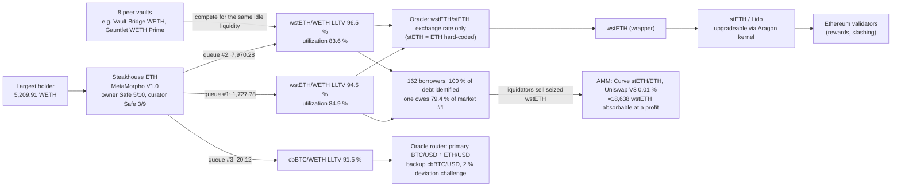

# ExitProof

**For a position in a MetaMorpho V1 vault, ExitProof executes your exit on a fork of Ethereum, alone and after others leave first (other large holders, and depositors of other vaults that lend in the same markets), and answers the portfolio manager's question: does the expected loss of staying justify exiting now, despite exit costs and the liquidity you cannot get out?** To explain the result and propagate shocks, it maps the vault's dependency stack from on-chain reads, as existing risk tools also do (see [Existing work](#existing-work-travaux-existants)).

Built for the BSA EPFL hackathon (10–11 October 2026), Belem Capital track, *DeFi Risk Dependency Challenge*.

Everything runs on **real Ethereum state frozen at block 26,157,638** (`0x3e84…7bf4`, 2026-10-09 21:47 UTC). Exits and shocks are **executed** on a local Hardhat 3 fork of that block. Each run can be replayed to the wei, and the replay also works offline.

> Every number in this README was produced by the code in this repository (`npm run all`, `npm run replay`).

## Existing work (Travaux existants)

ExitProof builds on ideas that are already public; it does not claim that mapping dependencies or estimating a risk probability is new.

- **Credora by RedStone** rates Morpho vaults bottom-up (collateral assets → markets → vaults) and publishes a **PSL**, the annualised Probability of Significant Loss (a 1 % loss), with a letter rating; a vault's PSL is the allocation-weighted PSL of its markets, adjusted for curator and governance. Ratings are shown in the Morpho app. Sources: [RedStone Credora FAQ](https://docs.redstone.finance/docs/redstone-credora/faq/), [How to rate Morpho](https://docs.redstone.finance/docs/redstone-credora/how-to-rate-morpho/), [Morpho vault methodology](https://credora-forum.discourse.group/t/morpho-vault-methodology/160). **API access:** the FAQ states that the API requires whitelisted access requested through a form; our unauthenticated requests to candidate endpoints returned 403/404 (10 Oct 2026). Nothing from Credora is integrated.
- **DefiLlama** publishes a risk page per vault (e.g. [this vault](https://defillama.com/yields/pool/e3cd6e7f-aefe-44bd-8e20-94304abd285d/risk)): collateral and markets behind the vault, the loss if a collateral drops by a chosen percentage, a modelled bad-debt ceiling, and oracle exposure, including oracles that follow an exchange rate or NAV rather than a market price. The "oracle blind to a market depeg" observation in this README is therefore of the same kind as what DefiLlama shows.
- **Credit spreads**: the classic approximation PD ≈ spread / LGD (default probability ≈ yield spread over a reference rate divided by the loss given default) is textbook credit risk; ExitProof uses it only as a risk-neutral reference next to the break-even, with the same caveats.
- **Shared-market contagion** between vaults is documented (e.g. LlamaRisk's Morpho vault risk disclaimer, articles on shared markets).

**What ExitProof adds, in one line:** exits *executed* on a fork of the real state (order of departures, contagion between vaults that share markets, with a bisected cushion), a break-even probability weighed against the measured cost of exiting, and a wei-exact replay of every number, offline.

## What it does

1. **Dependency discovery** (`src/discovery/`). It starts from the vault address alone and walks the stack with `eth_call` / `eth_getStorageAt` / `eth_getCode` at the frozen block. Each node and link of the graph lists the reads it rests on (contract, function, arguments, block, raw result).
   - L0 settlement chain → L1 vault: version checked with the factories' `isMetaMorpho`, plus owner, curator, guardian (Safe threshold read on-chain), timelock, fee and Public Allocator
   - L2 every Morpho Blue market of the withdraw queue: params, utilization, idle liquidity, the vault's withdrawable share
   - L3 oracle, IRM, collateral token, borrowers
   - L4 price feeds, exchange-rate adapters, oracle **routers** (primary/backup with a deviation challenge, behind EIP-1167 clones), the collateral yield source (wstETH → stETH / Lido) and token admins (proxy admin, owner, masterMinter)
   - L5 Chainlink aggregators, feed owners, Lido's Aragon kernel
   - **Peer vaults** that lend in the same markets and compete for the same liquidity, plus the **Public Allocator** backstop each of them could bring
   - **Borrowers** of each exposed market, with coverage measured on-chain (Σ borrow shares found / total borrow shares)
   - **Holders** of the vault (and the largest holder of each peer vault), balances re-read on-chain: who can drain the shared liquidity first
   - **Feed freshness**: age of every Chainlink answer at the block, next to the update behaviour **observed** over its last 24 rounds (`getRoundData`): longest interval between updates (heartbeat-like) and the move that triggers an update. Chainlink does not publish these on-chain, so they are inferred and labelled as such. Example: cbBTC/USD is 10.1 h old, but over its last 24 rounds it updated at most every 24.0 h or on ~2 % moves, so this age is normal.
   - **Frozen markets**: an oracle whose `price()` reverts at the block (seen on Adpend USDC) is reported, and its market is excluded from the shock propagation: nothing can be liquidated there.
   - **AMM layer**: the pools where liquidators can sell seized collateral (Uniswap V3 factory, Curve registry, through the unwrapped underlying, two hops via WETH), and how much they absorb at the block before a liquidation stops paying (quoted proceeds ≥ amount × oracle price / liquidation incentive)
2. **Shock propagation** (`src/shocks/analytic.ts`, `src/engine/scenario.ts`). A shock hits one discovered node and moves only along discovered edges: feed → oracle (active router leg only) → market → borrowers → vault → holder. Three shock types are modelled:
   - a price feed moves, and the oracle sees it;
   - the collateral **depegs on the market but the oracle is blind to it**;
   - an oracle overprices the collateral.

   Each feed shock is evaluated in two liquidation regimes: liquidators absorb everything, or liquidations stop where the AMM depth measured at the block runs out (the positions left over keep an unrecognised shortfall and bring no liquidity back).

   The impact is computed analytically for sensitivity sweeps, and **executed on the fork**: the oracle is replaced by a constant and every unhealthy borrower is liquidated with a real `liquidate` transaction. Bad debt is read from Morpho Blue's `Liquidate` event, then the vault and holder values are re-read. Exit runs (other holders, including holders of **other vaults**, leaving first) are executed the same way.
3. **Stay / exit verdict** (`src/verdict/verdict.ts`). The UI shows three numbers side by side and never claims to know the probability of a crisis: the **break-even p\*** below, the probability **implied by the yield spread** (vault net APY minus a sourced reference yield — Sky Savings Rate read on-chain for USD assets, the 7-day Lido staking yield measured on-chain for WETH; none for BTC assets — times the horizon, divided by the loss fraction ℓ of the incident; against "holding the asset idle" it would essentially equal the break-even (same yield given up, same loss), so it is not shown: risk-neutral, includes liquidity and smart-contract premia, not a prediction; undefined when the spread is ≤ 0, as it is for Steakhouse ETH and Steakhouse USDT at this block), and **your own assumption** (slider). No historical incident frequency is shown: none could be sourced with a date and a sample.
   Mechanics: Expected loss of staying = p × incident loss. Exit cost = forgone yield on what can leave now (net APY read on-chain) + gas out (gas used by the exit on the fork × base fee of the block) and back in (assumed equal to the exit's gas; no deposit is executed) + slippage on what is actually redeemed (value of the redeemed shares minus assets received, measured on the fork; locked funds are not slippage). Any part that cannot leave stays exposed. The tool outputs the **break-even probability p\*** and a sensitivity analysis. **p is the user's assumption, never a prediction.**
4. **Executed proof.** `results/manifests/<vault>.json` (sha256) records every scenario (inputs, timestamps `T0 + 12·k`, expected amounts, statuses, decoded errors). `npm run replay` re-executes them all on a fresh fork and compares to the wei, both online and offline (local proxy serving its disk cache).

## Results for Steakhouse ETH, largest holder (5,209.91 WETH = 53.6 % of the vault)

Data labels used everywhere: **on-chain** (real data read at the block) · **fork** (transaction simulated locally, never sent to Ethereum) · **hypothesis** (impersonated actors, shocks, probabilities).

**The stack discovered for this position** (every arrow is backed by recorded reads; numbers at block 26,157,638):



**Liquidity now (on-chain):** 9,718.21 WETH total, 6,946.905 withdrawable (71.5 %). About 2,771 WETH are lent to borrowers, mostly against wstETH. The Public Allocator could reallocate **0 WETH** into the exposed markets: the flow caps of the peer vaults are 0, or their other markets give no room.

**Who exits before you (fork, impersonated actors):**

| Exits executed first | Holder max withdraw (WETH) | Full exit | vs alone |
|---|---:|---|---:|
| nobody | 5,209.91 | ✓ | — |
| holder #3, #4, or both | 5,209.91 | ✓ | 0 % |
| holder #2 (Safe 3/5) | 4,210.68 | ✗ `NotEnoughLiquidity()` | −19.2 % |
| holder #2 then #3 | 3,489.01 | ✗ | −33.0 % |
| largest holder of **another vault** (Vault Bridge WETH) | 3,318.75 | ✗ | −36.3 % |
| holder #2 exits Gauntlet WETH Prime, then this vault | 2,079.21 | ✗ | −60.1 % |

**Cushion before blockage (fork, bisection):** the holder can still exit fully if holder #2 withdraws first up to 1,736.990 WETH. At 1,736.991 the full exit reverts.

**Dependencies that change the risk (on-chain):**
- Both wstETH markets (99.8 % of the vault's supply) are priced **only** by the `wstETH/stETH exchange rate` adapter, so stETH = ETH is hard-coded. If stETH depegs on the market, the oracle does not see it: no liquidation, no recognised loss, and no repaid liquidity comes back.
- The cbBTC market is priced by an **oracle router** whose primary leg is `BTC / USD ÷ ETH / USD`. The `cbBTC / USD` feed only sits in the backup leg, behind a 2 % deviation challenge.
- 8 peer MetaMorpho vaults lend in the same markets. 100 % of borrower debt was identified on-chain. In the 94.5 % LLTV market, one borrower holds 79.4 % of the debt.

**Shocks:**

| Shock | Recognised vault loss | Economic shortfall (unrecognised) | Holder max withdraw after a run by holder #2 + Vault Bridge #1 |
|---|---:|---:|---:|
| Lido backing loss −10 % (oracle sees it), executed: 90/90 liquidations | 293.106 WETH (analytic 293.084) | — | 5,052.78 (liquidations repay debt and bring liquidity back) |
| same, but liquidations limited by the AMM depth measured at the block: 45 executed on the fork, 45 positions left insolvent | 196.2 (analytic estimate; the verdict uses the fork-measured part + the analytic unrecognised part) | 78.8 | 5,104.73 |
| stETH market depeg −10 % (oracle blind), executed: 0 liquidatable | 0 | 219.0 WETH (analytic) | **582.53 (−89 %)** |

**AMM layer (on-chain quotes at the block):** liquidators can sell about 18,638 wstETH at a profit in the 96.5 % LLTV market, where borrowers have posted 25,174 wstETH (74 %). Most of that depth is the Curve stETH/ETH pool, reached by unwrapping, then the Uniswap V3 0.01 % pool.

**Verdict (defaults: p = 5 %, 30-day horizon, yield given up = the vault's net APY of 1.53 % read on-chain, locked funds valued at a 10 % haircut; all shown next to the break-even in the UI):** in the oracle-blind incident, EXIT is the answer as soon as the holder's own incident probability exceeds **1.13 %** over 30 days. Sensitivity runs from 0.06 % (7 days, 50 % haircut) to 16.7 % (90 days, no haircut). The Lido-loss incidents break even at 4.16 % (all liquidations) and 4.44 % (AMM-limited).

## The same pipeline on other vaults (generic catalog)

For any MetaMorpho V1 vault, the scenarios are derived from the graph:
- the target is the largest holder;
- the competing exits are the next three holders, plus the largest holder of each of the three peer vaults that share the most liquidity;
- the value shock is the feed whose −10 % move hurts the vault most, plus an oracle-blind depeg of the main collateral.

**Gauntlet WETH Prime** (largest holder 2,131.47 WETH, 68 % of the vault). On its own, the vault is 100 % liquid: no exit by its own holders affects the largest holder. But if the largest holder of **Steakhouse ETH** exits its own vault first, the full exit reverts and only 1,817.28 WETH can leave (−14.7 %). With all the competing exits combined, only 1,274.42 can leave (−40.2 %). The vault looks fully liquid, yet 97 % of what it supplies sits in the same two wstETH markets as Steakhouse ETH.

**Steakhouse USDC** (219 nodes, 13 peer vaults, 12 markets in the withdraw queue). Liquidations are executed in USDC: the liquidator's balance slot is found by probing and written on the fork. The largest holder (30.56 M USDC) loses 5 % of its exit when all the competing holders leave first. The verdict says STAY in every incident: the exit cost (forgone yield) is larger than the loss the incidents can cause.

## Analyse any vault, and what happens with unusual ones

The UI has an **Analyze** box: paste any MetaMorpho V1 address. The analysis runs as a background job (POST `/api/analyze`, then GET `/api/analyze?vault=` for its stage and log), so long runs never time out in the browser. Bench (`scripts/robustness.mjs`), all from addresses never analysed before:

| Case | Result |
|---|---|
| Steakhouse USDT (V1.0, 73 % liquid) | report in 33 s (warm cache) / 331 s (cold), replay OK |
| Smokehouse USDT (V1.1, 62 % liquid) | report + replay OK |
| Hakutora USDC (V1.1, ~100 % liquid) | report + replay OK |
| Clearstar Yield USDC (V1.1, 0 % liquid) | report: nothing can be withdrawn; no shock can be built (no incident), said so in the UI |
| Adpend USDC (V1.1, 0 % liquid, an oracle whose `price()` reverts) | report: 0.0001 % exitable → "exiting is practically impossible"; frozen market reported |
| Gauntlet DAI Core (V1.0, 15 % liquid), Metronome msETH (V1.0, 32 %) | report + replay OK |
| `hello`, `0x1234` | 400: not an Ethereum address |
| an EOA, the USDC token, Morpho Blue | 422 with the reason: "no code: a wallet", "an ERC-20 token, not a vault", "a contract that does not expose a vault interface" |
| a Morpho Vault V2 (`0x0229…09ae`), sUSDS (another ERC-4626) | 422 with the reason: V2 allocates through adapters and its `maxWithdraw` does not report available liquidity; other ERC-4626 vaults have unknown withdrawal rules |

**Pre-analysed:** the 20 largest MetaMorpho V1 vaults on Ethereum by TVL with an ETH, BTC or USD asset (list from the Morpho API, `scripts/top-vaults.mjs`), plus the bench vaults: 23 vaults in `results/`, each with a report and a manifest replayed to the wei. Pasting one of them is instant, also offline.

Other readable errors: 409 when another analysis is running; 503 when the archive RPC is unreachable or rate-limited, or in offline mode for a vault never analysed online.

**Public Allocator, executed.** When a peer vault lets anyone pull its liquidity into the target's markets, a scenario replays the worst run, then calls `reallocateTo` on the Public Allocator (amounts computed on the fork within flow caps, supply-cap headroom and market liquidity, fee paid) before the holder's exit. On Steakhouse USDT, the largest holder's exitable amount goes from 46.73 M to 50.47 M USDT after 3.75 M USDT are moved. For Steakhouse ETH there is no net liquidity to pull (0 WETH), and the UI says so.

**Evidence ledger.** A UI section lists every headline number with its class: measured on-chain, executed on the fork, bounded (upper or lower bound), modeled, or hypothesis. Each row gives its source call or scenario and its hypotheses.

## Run it

Requirements: Node 24, Windows/macOS/Linux. No API key is needed: the default upstream is `https://eth.drpc.org`. To use your own archive RPC, set `EXITPROOF_RPC_URL`; it is never written to disk or committed.

```bash
npm install
npm run proxy            # terminal 1: local RPC proxy on 127.0.0.1:8600 (online)
npm run fork             # terminal 2: Hardhat 3 fork of block 26,157,638 through the proxy
npm run all              # for the 3 demo vaults: discovery -> executed scenarios, cushion, shocks, verdict -> replay check
                         #   (or per vault: npm run discover -- 0x..., npm run build:report -- 0x... [holder], npm run replay -- 0x...)
npm test                 # unit tests (verdict, analytic engine on a synthetic graph, liquidation incentive, decoding)
node scripts/robustness.mjs   # /api/analyze on 7 unknown vaults + 5 invalid inputs (needs api, fork, proxy)
npm run test:fork        # acceptance on the fork: reference values to the wei
npm run api              # terminal 3: local API on 127.0.0.1:8700
npm run web              # terminal 4: UI on http://127.0.0.1:5173
```

**First run:** with an empty cache, the first replay or pipeline run fetches state from the archive RPC (about 2 minutes for Steakhouse ETH; rate limits of the free endpoint are retried by the proxy). Verified from a fresh clone: `npm ci`, `npm run proxy`, `npm run fork`, `npm run replay` → REPLAY OK.

**Offline:** once the cache is warm (one online run), stop the proxy, start `npm run proxy:offline`, restart the fork, then run `npm run replay`. Discovery also runs offline with `EXITPROOF_OFFLINE=1` (Morpho API answers are cached too). The proxy logs every request it refuses in `cache/proxy.log`.

## Architecture

| Module | Role |
|---|---|
| `src/proxy/rpcProxy.ts` | Local JSON-RPC proxy. Hardhat's fork cache is keyed by host:port, so the fork always goes through `127.0.0.1:8600`. The proxy keeps a disk cache of deterministic requests (explicit block, including reverts) and runs online or offline. |
| `src/engine/fork.ts` | Snapshot (id persisted between processes), impersonation + `setBalance`, `evm_setNextBlockTimestamp(T0+12k)`, raw JSON-RPC to keep revert data, error decoding |
| `src/engine/scenario.ts` | Declarative scenarios: exits, oracle override (constant-returning bytecode), liquidate-all, measurements |
| `src/engine/cushion.ts` | Bisection executed on the fork |
| `src/discovery/` | Provenance-tracking reader, layered discovery, Morpho API candidate lists (verified on-chain), AMM venues and liquidation capacity (`dex.ts`) |
| `src/scenarios/` | Curated catalog (Steakhouse ETH, reference values) and generic catalog derived from any graph |
| `src/shocks/analytic.ts` | Propagation over the graph (bad debt with Morpho's liquidation incentive factor, hidden shortfall, overpricing, AMM-limited liquidations) |
| `src/verdict/verdict.ts` | Break-even and decision; the UI imports this same file |
| `src/report/build.ts`, `src/cli/replay.ts` | Pipeline, manifest, replay |
| `src/server/server.ts`, `web/` | Local API (live fork runs, replay) and React UI |

## What works / partial / excluded

- **Works:** everything above, for any MetaMorpho V1.0/V1.1 vault (shown on 23: WETH, WBTC, USDC, USDT, DAI and msETH vaults, liquid from 0 % to 100 %, see above). On V1.1 the share price does not drop after bad debt (`lostAssets`), so losses are measured on the vault's real assets (sum of its market positions): fork 143.731 vs analytic 143.734 WETH for a −10 % feed shock on Vault Bridge WETH. Wei-exact replay online and offline. Unit and fork acceptance tests.
- **Partial:**
  - The AMM capacity is a lower bound. Only Uniswap V3 and Curve are counted (direct pools, plus the best two-hop route via WETH); aggregators and other DEXes are not. Depth is assumed to scale with the shocked price.
  - Gas is paid in ETH; for non-ETH vaults it is shown in ETH and not converted (no sourced price).
  - Peer vaults and borrowers are *enumerated* from Morpho's public API, because the free archive RPC does not serve historical `eth_getLogs`. Every candidate is re-read on-chain and completeness is measured on-chain.
  - Allocators other than the Public Allocator are not enumerated.
- **Excluded:**
  - MetaMorpho V2 and other vault types, which are refused explicitly (their `max*` semantics differ).
  - USD values: native units only.
  - Anything after the frozen block: ExitProof describes one state, not its evolution.

## Known limitations (Limites connues)

What is **bounded** (a measured upper or lower bound, not an exact value):
- AMM liquidation capacity: lower bound (Uniswap V3 and Curve only, direct pools plus the best two-hop route via WETH; aggregators and other DEXes excluded).
- Public Allocator backstop: upper bound (peers drawing on the same source market share its liquidity); executed only in the mitigation scenario.
- Oracle-blind economic shortfall: lower bound for holders who stay (first exiters leave at full value).

What is **modelled** (computed from measured inputs with stated hypotheses):
- Analytic shock propagation: instantaneous price move, every unhealthy borrower liquidated (or as many as the AMM depth allows), no top-ups, interest ignored (the fork runs include it; cross-checks agree within interest accrued).
- Break-even probability: exit cost over the incident loss times the exitable share; the horizon, net APY, locked-funds cost are user or default inputs shown next to the result.
- Spread-implied probability: risk-neutral, includes liquidity and smart-contract premia, depends on the chosen reference yield.
- Feed heartbeat and deviation threshold: inferred from the last 24 rounds, not read from Chainlink.
- Re-entry gas assumed equal to the exit gas; gas not converted into non-ETH assets (no sourced price).

What the tool **does not do**:
- No prediction: it does not estimate the probability of any incident; probabilities are the user's assumptions, or a risk-neutral reading of the spread.
- Not investment advice, not an audit, not a rating.
- MetaMorpho V1.0 and V1.1 only. Morpho Vault V2 (adapters), other ERC-4626 vaults, tokens and wallets are refused with an explanation.
- One frozen block (26,157,638): no evolution after it, no repayments, re-allocations by curators or new deposits.
- Other actors are impersonated on a local fork: their exits are scenarios, not their intentions.
- Peer vaults, borrowers and holders are enumerated from the Morpho API (candidates) and verified on-chain; an address the API omits can be missed (coverage is measured and shown).
- Vaults never analysed online cannot be analysed offline (the cache is empty for them).

## Assumptions and honesty

- No transaction is ever sent to Ethereum: only reads on the RPC, and `eth_sendTransaction` on the local node.
- Impersonated actors are a scenario hypothesis, not their signature or intention. The largest holder's contract reports a name; it is not verified and is not used.
- The cross-vault exit mechanism is already documented (e.g. LlamaRisk's Morpho vault risk disclaimer, articles on shared markets). ExitProof's contribution is to **execute** it and put a number on it for one position at one block, with a replay.
- The economic shortfall of an oracle-blind depeg assumes the depeg persists and underwater borrowers walk away. It is not a loss recognised on-chain and is labelled as such. It is split pro rata of current shares, which is a **lower bound** for holders who stay: those who exit first leave at full value and the shortfall concentrates on the rest.

## Origine des composants (component origin)

- **Written during the event (10–11 Oct 2026):** all code in this repository: proxy, fork engine, scenarios, discovery, shocks, verdict, report, replay, API and UI. It was written from scratch in a fresh repository (see the git history).
- **Prior preparation (night of 9–10 Oct 2026):** desk research and a throwaway feasibility check, kept in a separate research folder that is **not** included here. That check covered RPC archive availability, whether a Hardhat 3 fork works at this block, and the reference values for this vault and block. Only **facts** were reused: public addresses, block number and hash, and the reference amounts used as acceptance tests. Its code was not copied.
- **Libraries (all via npm):**
  - viem 2.57.4 (MIT), Hardhat 3.19.0 (MIT), React / React-DOM 19.3.0 (MIT), Vite 8.3.4 (MIT), @vitejs/plugin-react 6.1.2 (MIT), tsx 4.23.15 (MIT), TypeScript 7.0.2 (Apache-2.0)
  - Data sources: Ethereum archive RPC (dRPC public endpoint) and Morpho public GraphQL API, used for candidate lists only.
- **AI assistance:** the code was written with Claude Code (Anthropic), working with the team member who directed the work and reviewed the results. No AI is used in any computation of the tool.

## License

MIT
