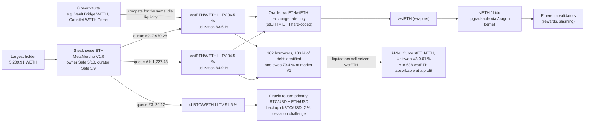

# ExitProof

**Exit tool for Morpho vaults: what do I really get back, and from what probability does leaving pay off.**

One protocol, MetaMorpho V1 on Morpho Blue. For a position, ExitProof executes the withdrawal on a fork of Ethereum frozen at block 26,157,638 (`0x3e84…7bf4`, 2026-10-09 21:47 UTC), alone and after other depositors leave first, and weighs the measured cost of leaving against the loss of staying through an incident. Every number can be replayed to the wei, offline.

> Every number in this README was produced by the code in this repository (`npm run all`, `npm run replay`). Labels used everywhere: **measured on the fork** (exit liquidity), **modeled** (value loss, lower bound), **your assumption** (probabilities).

## Main screen

One screen, no scrolling on a phone (375×667): pick a pool, enter how much you put in (default: the largest position; optional price of 1 unit in € to see euros, empty by default), then
- the exit word: **Easy exit** (at least 90 % of the largest deposit gets out even in the worst executed case), **Tight exit** (50–90 %), **Hard exit** (below 50 %, or not everything can get out even alone); these limits are a choice;
- one number: "If others leave first, X of your A WETH comes out right away" (the worst executed case at your size) with a bar, and "Y would wait" when something waits;
- one neutral line: "The break-even is 1 in N this month (1 in M if blocked money costs nothing)", which turns into "Stay" or "Leave" once you move the slider (thumb in the middle until then);
- "Replay" (static: the recorded replay) or "Run the exit" (live, see below), and "Why?".

**Your size, two ways.** *Scaled* (static site, and live before a run): what gets out right away = min(amount, liquidity left in the worst executed case: 2,079.21 WETH for Steakhouse ETH), the rest waits; above the largest measured position the amount is capped ("Above the measured range"). The word and the break-even are recomputed at that size with the same `decide()` and thresholds (gas from the report, cost of blocked money only on the part that waits). *Simulated on the fork* (live, "Run the exit"): a test account really deposits the amount (WETH: `hardhat_setBalance` then a real `WETH.deposit()`; other assets: the token's `balanceOf` storage slot is written, found by probing Solidity and Vyper layouts and checked with `balanceOf`; checked on USDC and USDT), then the worst case is replayed (the others leave first, from both vaults), then the account exits; gas actually used is recorded; the fork is reset to its base state before and after, even on error (two runs give the same result to the wei). If the fork does not answer: "Fork not reachable: scaled from the measured case".

Verification on Steakhouse ETH (live, 10 Oct 2026):

| amount | predicted (scaled) | measured on the fork | identical to the wei? |
|---|---:|---:|---|
| 0.5 | 0.500000000000000000 | 0.500000013024452097 | no (+0.000000013) |
| 100 | 100.000000000000000000 | 100.000002536129810994 | no (+0.0000025) |
| 2,079.21 | 2,079.210000000000000000 | 2,079.210037627559645973 | no (+0.000038) |
| 2,079.22 | 2,079.210741633111021926 | 2,079.220037627722242574 | no (+0.0093) |

Two gaps, both shown, not hidden: (1) interest accrues during the simulation (each transaction is 12 s later), about 2.5 × 10⁻⁸ of the amount; (2) a fresh deposit adds its own cash to the pool, so above 2,079.21 everything still gets out, whereas the scaled case describes money already lent out at the frozen block. The screen says "New money adds cash." when this happens.

For Steakhouse ETH: Hard exit, 2,079.21 of 5,209.91 WETH, leave above 1 in 89. Over the 23 precomputed vaults: 11 Easy exit, 3 Tight exit, 9 Hard exit. "Why?" opens four short blocks (if a problem hits, who depends on whom, money stuck for a while, what this tool cannot see), with a "?" on each technical term and a glossary at `#/glossary`. Text budget, tested: 41 words on the main screen (95 before), at most 40 per block, no sentence over 20 words. Everything else (all numbers, the dependencies, the proof) is in "Expert mode", closed by default.

## 1. What do I really get back?

Steakhouse ETH, largest holder (5,209.91 WETH, 53.6 % of the vault). Same block, same state; only the order of exits changes. Other holders are impersonated on the fork: their exits are scenarios, not their intentions.

| Exits executed before mine | I get (WETH) | Full exit | vs alone |
|---|---:|---|---:|
| nobody | 5,209.91 | ✓ | — |
| holder #3, #4, or both | 5,209.91 | ✓ | 0 % |
| holder #2 (Safe 3/5) | 4,210.68 | ✗ `NotEnoughLiquidity()` (0x4323a555) | −19.18 % |
| holder #2 then #3 | 3,489.01 | ✗ | −33.03 % |
| largest depositor of **another vault** (Vault Bridge WETH), which holds no share of mine | 3,318.75 | ✗ | −36.30 % |
| holder #2 exits Gauntlet WETH Prime, then this vault | 2,079.21 | ✗ | −60.09 % |

**Cushion (bisection on the fork):** my full exit survives as long as less than 1,736.990 WETH leaves before me; at 1,736.991 it reverts.

## 2. From what probability does leaving pay off?

Break-even p* = exit cost ÷ (incident loss × share of the position that can leave now). Exit cost = yield given up on what leaves (1.53 % net APY, read on-chain) + gas executed on the fork + measured slippage. **The probability is yours: nothing here predicts it.**

For the decisive incident — stETH depegs on the market, the exchange-rate oracle does not see it, holder #2 and Vault Bridge's largest depositor exit first (after which only 582.53 WETH can leave) — over 30 days:

| Locked funds valued at | Incident loss L | p* |
|---|---:|---:|
| 10 % (assumption) | 580.15 WETH (117.41 modeled value loss + 462.74 locked) | **1.13 %** |
| 0 % (assumption) | 117.41 WETH | **5.57 %** |

Both are shown with the same weight: the difference is an assumption, not a measurement. Next to them the UI shows the probability implied by the yield spread (classic PD ≈ spread / LGD, risk-neutral): here it is **not evaluated**, because the vault yields 1.53 %, less than the 7-day Lido staking yield measured on-chain (2.24 %), so the spread prices no default risk.

**Not modeled — total-loss threshold.** Smart-contract hacks, governance attacks and oracle exploits beyond the modeled price moves are not simulated. For a hack (no warning), the same function with the same parameters and a total loss of the position gives p* = 0.03 % (7 days), 0.13 % (30 days), 0.38 % (90 days): above that probability, leaving now pays off. Other risk teams also avoid predicting hack probabilities; we show the threshold instead. For a **governance attack** the vault's configuration changes wait 7 days (timelock, read on-chain) and a guardian contract can veto them: the threshold applies only to a holder who does not watch the vault's pending changes; one who does can leave during those 7 days. This timelock concerns the vault's settings and is unrelated to the liquidity lock measured above.

### References next to the probability (not forecasts)

Computed once from data already read or executed, stored in `results/` with their provenance and read from files by the site (`npm run history`, `npm run refine` to regenerate):

- **How often has this shock happened?** The Chainlink stETH/ETH feed (`0x8639…2812`, "STETH / ETH"; *not* used by the market's oracle, read only as a record) has 2,020 rounds in 2 phases, read at the source block. From 2021-08-25 to 2026-10-08 (1,871 days, 62 non-overlapping 30-day windows), every round is used; the drop in a window is the largest fall from a high to a later low (intraday). Windows with a drop of at least 1 %: 13 of 62; 3 %: 3 of 62; 5 %, 10 %, 15 %, 20 %: 0 of 62. The worst window fell 4.75 % (high on 2022-06-01, low on 2022-06-18). Percentiles of drops: 0.15 % (95th) and 0.60 % (99th) over 1 day, 2.83 % and 4.54 % over 30 days (overlapping spans). The previous once-a-day sample, kept for comparison in the file and the UI, gave 6, 1, 0, 0, 0, 0 of 62 and a 1-day 99th percentile of 0.46 %: it missed fast falls such as 10 Oct 2025. The feed may update only every 24 h when the price is calm, and it does not show DEX prices, so short dips there can be deeper. One event is not a distribution: these are counts, not probabilities, and the UI shows no single percentage when k ≤ 3 (`results/history/steth-eth.json`, sha256 inside).
- **Break it down:** in the UI, p = P(shock of at least s within 30 days) × P(others exit first | shock). The first factor starts at the historical count above (labelled as a reference) and can be moved; the second is entirely the user's. Direct entry stays the default; no verdict before a slider is moved.
- **Vault-level loss:** the decisive incident's modeled loss is pro rata of vault supply, so holder loss ÷ holder value = vault loss ÷ vault assets = **2.25 %** for Steakhouse ETH (219.02 WETH of 9,718.21). The UI calls it an economic shortfall at vault level (not realized bad debt): the exchange-rate oracle does not recognise it on-chain. Credora's probability of significant loss counts bad debt above 1 % of principal ([DefiLlama research, "The year of risk-aware DeFi: Credora ratings as the $1T unlock primitive"](https://defillama.com/research/report/the-year-of-riskaware-defi-credora-ratings-as-the-1t-unlock-primitive)); the comparison is therefore approximate. That page and the Credora forum refused or did not answer our automated requests on 10 Oct 2026 (HTTP 403, DNS), so the wording was not re-read by us.
- **Concentration and utilization** (Dependencies tab): Herfindahl index of the vault's supply across funded markets, 0.70 (concentrated), and by collateral, 1.00 (wstETH 99.8 %, cbBTC 0.2 %), with the US DOJ/FTC 2010 thresholds (0.15 / 0.25), which come from antitrust guidelines, not from a DeFi vault standard (said in a tooltip), and no letter grade. Utilization 84.9 %, 83.6 % and 87.1 % against Gauntlet's guideline that a market should not exceed 90 % for more than 48 hours (the duration is not measured here).
- **Two shock regimes** (Shocks tab, Block Analitica's 10 % pegged / 40 % volatile defaults): same analytic engine, no new simulation, markets where the vault has funds only. Steakhouse ETH: 99.8 % of assets in the pegged regime (wstETH), vault loss 2.25 % at −10 %; 0.2 % in the volatile regime (cbBTC), 0.03 % at −40 %. Regimes are assigned by symbol family (ETH, USD, BTC, EUR).
- **10 October 2025** (a day of very large liquidations): every round of the same feed between 9 Oct 00:00 and 13 Oct 00:00 UTC (26 updates). Last reading of 9 Oct: 0.999667 (18:35:11 UTC); lowest: 0.955694 (10 Oct, 21:28:23 UTC); largest drop 4.40 %, about 7.3 times the 99th percentile of 1-day drops (0.60 %, every round). 26 h 53 min separate the two readings because the feed only updates every 24 h when calm; the fall itself took 7 min 48 s (first reading more than 0.5 % lower at 21:20:35) and the feed was back within 0.5 % 38 min 48 s after the low. A once-a-day sample recorded only 0.45 % that day, which is why the counts above now use every round. Chainlink feed reading, not a DEX price; it says nothing about how any vault behaved and does not validate the model.
- **Rule of three:** when a size never happened (k = 0 of N windows), the UI adds that the frequency could still be as high as about 3/N (≈ 4.8 % of 30-day windows for N = 62, about 95 % confidence).
- **Exit window** next to the big number: "Immediate" when the executed full exit succeeds, otherwise the share that can leave now.

## 3. Why: the dependency stack (explanation only)

The stack is mapped from on-chain reads at the block, starting from the vault address; each link keeps the read it rests on. It explains the numbers above:



- Both wstETH markets (99.8 % of the vault's supply) are priced by the `wstETH/stETH exchange rate` only: a market depeg of stETH is not seen by liquidations.
- Eight other MetaMorpho vaults lend in the same markets and compete for the same idle liquidity; that is why a depositor of another vault can cut my exit.
- The Morpho Public Allocator could bring **0 WETH** of net liquidity into these markets at this block.

## 4. Proof: replay to the wei

`results/manifests/<vault>.json` (sha256) records every executed scenario: inputs, timestamps `T0 + 12·k`, expected amounts, statuses and decoded errors. `npm run replay` re-executes them on a fresh fork and compares to the wei (transaction hashes are not compared). Verified on a clean clone, offline after one online warm-up: `npm run test:fork` 9/9, `npm run replay` REPLAY OK (raw outputs in `results/clean-clone-check/`).

The same pipeline runs on any MetaMorpho V1.0/V1.1 vault; 23 vaults (the 20 largest by TVL plus test cases) are precomputed in `results/`. Morpho Vault V2 and other contracts are refused with the reason.

## See it without installing anything

Open **`docs/index.html`** (double-click): a static replay of `results/` — no fork, no RPC key, no network. Or publish `docs/` with GitHub Pages (folder `/docs`) or Vercel (output directory `docs`). A permanent banner says these are results executed on a fork frozen at block 26,157,638, replayed from the manifests. Rebuild with `npm run build:static`.

## Live demo in one command

```bash
npm ci
npm run demo                 # proxy → fork → API → web, health-checked, restarted if they die, browser opened
npm run demo -- --offline    # the proxy serves its disk cache only (after one online run)
```

`http://127.0.0.1:5173/#/status` shows proxy, fork, API and mode. If the fork stops answering, the UI switches to the static replay with a visible banner.

Other commands: `npm run proxy`, `npm run fork`, `npm run replay [-- 0x<vault>]`, `npm run all` (rebuild results), `npm test` (14 unit tests), `npm run test:fork` (9 acceptance tests on the fork), `npm run test:e2e` (115 end-to-end checks in the installed Chrome, see below). No API key is needed (default upstream `https://eth.drpc.org`); a private archive RPC can be set with `EXITPROOF_RPC_URL`, never written to disk or committed.

## How it works (short)

| Module | Role |
|---|---|
| `src/engine/` | Fork engine: snapshot, impersonation, timestamps `T0 + 12·k`, revert decoding, scenarios, cushion bisection |
| `src/discovery/` | On-chain reads with provenance: vault, markets, oracles, collateral, peer vaults, holders, borrowers |
| `src/shocks/analytic.ts` | Value loss of an incident (bad debt with Morpho's liquidation incentive, unrecognised shortfall); cross-checked against executed liquidations (293.106 vs 293.084 WETH for a −10 % Lido loss) |
| `src/verdict/verdict.ts` | Break-even p* (one function for every number above) |
| `src/report/build.ts`, `src/cli/replay.ts` | Pipeline, manifest, replay |
| `src/proxy/rpcProxy.ts` | Local RPC proxy with a disk cache of block-pinned requests (offline mode) |
| `src/server/`, `web/`, `docs/` | Local API, UI, static replay build |

## Existing work (Travaux existants)

ExitProof builds on ideas that are already public; it does not claim that mapping dependencies or estimating a risk probability is new.

- **Credora by RedStone** rates Morpho vaults bottom-up (collateral assets → markets → vaults) and publishes a **PSL**, the annualised Probability of Significant Loss (a 1 % loss), with a letter rating; a vault's PSL is the allocation-weighted PSL of its markets, adjusted for curator and governance. Ratings are shown in the Morpho app. Sources: [RedStone Credora FAQ](https://docs.redstone.finance/docs/redstone-credora/faq/), [How to rate Morpho](https://docs.redstone.finance/docs/redstone-credora/how-to-rate-morpho/), [Morpho vault methodology](https://credora-forum.discourse.group/t/morpho-vault-methodology/160). **API access:** the FAQ states that the API requires whitelisted access requested through a form; our unauthenticated requests to candidate endpoints returned 403/404 (10 Oct 2026). Nothing from Credora is integrated.
- **DefiLlama** publishes a risk page per vault (e.g. [this vault](https://defillama.com/yields/pool/e3cd6e7f-aefe-44bd-8e20-94304abd285d/risk)): collateral and markets behind the vault, the loss if a collateral drops by a chosen percentage, a modelled bad-debt ceiling, and oracle exposure, including oracles that follow an exchange rate or NAV rather than a market price. The "oracle blind to a market depeg" observation in this README is therefore of the same kind as what DefiLlama shows.
- **Credit spreads**: the classic approximation PD ≈ spread / LGD (default probability ≈ yield spread over a reference rate divided by the loss given default) is textbook credit risk; ExitProof uses it only as a risk-neutral reference next to the break-even, with the same caveats.
- **Gauntlet** ([VaultBook](https://vaultbook.gauntlet.xyz/llms-full.txt)) sizes stress with the 99th percentile day-over-day price drop and states that a market's utilization should not exceed 90 % for an extended period (> 48 hours); we reuse the percentile idea on the stETH/ETH history and the 90 % level as a reference line.
- **Block Analitica and B.Protocol** ([MetaMorpho risk model](https://forum.morpho.org/t/introducing-metamorpho-risk-model/447)) use default shocks of 10 % for pegged and 40 % for volatile assets; we reuse those two sizes as regimes.
- **Credora** also publishes [vault diversification adjustments](https://credora-forum.discourse.group/t/methodology-enhancement-proposal-vault-diversification-adjustments/170); our concentration index is a plain Herfindahl index, not Credora's adjustment (forum not reachable from our network on 10 Oct 2026, not re-checked).
- **Morpho** lists the risks for depositors in its [documentation](https://docs.morpho.org/learn/resources/risks/) (smart-contract, oracle, liquidity, curator/governance), which is the list our "Not modeled" section follows.
- **Shared-market contagion** between vaults is documented (e.g. LlamaRisk's Morpho vault risk disclaimer, articles on shared markets).

**What ExitProof adds, in one line:** exits *executed* on a fork of the real state (order of departures, contagion between vaults that share markets, with a bisected cushion), a break-even probability weighed against the measured cost of exiting, and a wei-exact replay of every number, offline.

## Known limitations (Limites connues)

What is **bounded** (a measured upper or lower bound, not an exact value):
- AMM liquidation capacity: lower bound (Uniswap V3 and Curve only, direct pools plus the best two-hop route via WETH; aggregators and other DEXes excluded).
- Public Allocator backstop: upper bound (peers drawing on the same source market share its liquidity); executed only in the mitigation scenario.
- Oracle-blind economic shortfall: lower bound for holders who stay (first exiters leave at full value).

What is **modelled** (computed from measured inputs with stated hypotheses):
- Analytic shock propagation: instantaneous price move, every unhealthy borrower liquidated (or as many as the AMM depth allows), no top-ups, interest ignored (the fork runs include it; cross-checks agree within interest accrued).
- Break-even probability: exit cost over the incident loss times the exitable share; the horizon, net APY, locked-funds cost are user or default inputs shown next to the result.
- Spread-implied probability: risk-neutral, includes liquidity and smart-contract premia, depends on the chosen reference yield.
- Feed heartbeat and deviation threshold: inferred from the last 24 rounds, not read from Chainlink.
- Re-entry gas assumed equal to the exit gas; gas not converted into non-ETH assets (no sourced price).

What the tool **does not do**:
- No prediction: it does not estimate the probability of any incident; probabilities are the user's assumptions, or a risk-neutral reading of the spread.
- Not investment advice, not an audit, not a rating.
- MetaMorpho V1.0 and V1.1 only. Morpho Vault V2 (adapters), other ERC-4626 vaults, tokens and wallets are refused with an explanation.
- One frozen block (26,157,638): no evolution after it, no repayments, re-allocations by curators or new deposits.
- Other actors are impersonated on a local fork: their exits are scenarios, not their intentions.
- Peer vaults, borrowers and holders are enumerated from the Morpho API (candidates) and verified on-chain; an address the API omits can be missed (coverage is measured and shown).
- Vaults never analysed online cannot be analysed offline (the cache is empty for them).

## Assumptions and honesty

- No transaction is ever sent to Ethereum: only reads on the RPC, and `eth_sendTransaction` on the local node.
- Impersonated actors are a scenario hypothesis, not their signature or intention. The largest holder's contract reports a name; it is not verified and is not used.
- The cross-vault exit mechanism is already documented (e.g. LlamaRisk's Morpho vault risk disclaimer, articles on shared markets). ExitProof's contribution is to **execute** it and put a number on it for one position at one block, with a replay.
- The economic shortfall of an oracle-blind depeg assumes the depeg persists and underwater borrowers walk away. It is not a loss recognised on-chain and is labelled as such. It is split pro rata of current shares, which is a **lower bound** for holders who stay: those who exit first leave at full value and the shortfall concentrates on the rest.

### End-to-end test of the site

`npm run test:e2e` drives the Chrome already installed on the machine (playwright-core, `channel: "chrome"`, no browser download). It serves `docs/` on a local port and also opens it from disk (`file://`), at 1440 px and 375 px, and checks: no console error and no request leaving the machine; hero facts equal to the index, manifests and replays; the five scenario amounts equal to `results/reports` (plus 5,209.91 / 4,210.68 / 3,489.01 / 3,318.75 / 2,079.21 as guard values); cushion 1,736.990 and `NotEnoughLiquidity (0x4323a555)` in Details; break-evens 1.13 % / 5.57 %, the 10 %/0 % switch and no verdict before the slider moves; Not modeled 0.03 % / 0.13 % / 0.38 %; all 23 vaults (number, no NaN/undefined/null, Replay tab showing REPLAY OK and the manifest sha256 recomputed by the test); colour contrast (axe-core) in both themes; mobile text ≥ 16 px and tap targets ≥ 44 px; a still background with reduced motion; keyboard access. If `npm run demo` is running it also checks live mode (badge, "Execute this again on the fork" identical to the wei, refusal of a non-V1 address, simulated fork outage); otherwise those checks are skipped and the output says so. `E2E_KILL_FORK=1` additionally kills the real fork process. A deployed copy is tested with `E2E_URL=https://… npm run test:e2e:url` (PowerShell: `$env:E2E_URL="https://…"; npm run test:e2e:url`). Failures leave a screenshot in `results/e2e-failures/`; timings in `results/e2e/last-run.json`.

## Origine des composants (component origin)

- **Written during the event (10–11 Oct 2026):** all code in this repository: proxy, fork engine, scenarios, discovery, shocks, verdict, report, replay, API and UI. It was written from scratch in a fresh repository (see the git history).
- **Prior preparation (night of 9–10 Oct 2026):** desk research and a throwaway feasibility check, kept in a separate research folder that is **not** included here. That check covered RPC archive availability, whether a Hardhat 3 fork works at this block, and the reference values for this vault and block. Only **facts** were reused: public addresses, block number and hash, and the reference amounts used as acceptance tests. Its code was not copied.
- **Libraries (all via npm):**
  - viem 2.57.4 (MIT), Hardhat 3.19.0 (MIT), React / React-DOM 19.3.0 (MIT), Vite 8.3.4 (MIT), @vitejs/plugin-react 6.1.2 (MIT), tsx 4.23.15 (MIT), TypeScript 7.0.2 (Apache-2.0)
  - Tests only (devDependencies): playwright-core 1.63.0 (Apache-2.0), axe-core 4.13.0 (MPL-2.0); they drive the locally installed Chrome and are not shipped in `docs/`.
  - Font: Outfit (SIL Open Font License 1.1), woff2 files taken from @fontsource/outfit 5.3.0 and embedded in `web/public/fonts` → `docs/fonts` with their license file; no font CDN. The animated waves in the background are drawn by our own canvas code (no library, no image or video).
  - Data sources: Ethereum archive RPC (dRPC public endpoint) and Morpho public GraphQL API, used for candidate lists only.
- **AI assistance:** the code was written with Claude Code (Anthropic), working with the team member who directed the work and reviewed the results. No AI is used in any computation of the tool.

## License

MIT
